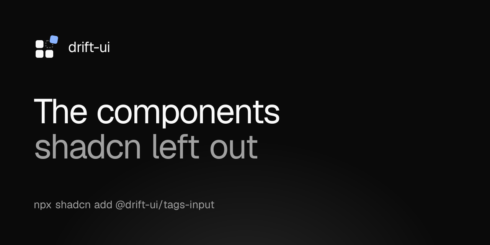

# drift-ui



A shadcn-compatible component registry built on React 19, Tailwind v4, and Radix or Base UI. It covers the components shadcn/ui leaves out, like a tags input, stepper, tree view and file dropzone, and installs them with the shadcn CLI.

Browse the live previews at [drift-ui.dev](https://drift-ui.dev).


## Components

61 components, grouped the same way as the docs site. The primitives have the same API as their shadcn/ui counterparts, so skip any you already have. Every component page has a live preview, its source, install steps and an Open in v0 link.

| Category   | Components                                                                                                                                                                                                                                                                                                                                                                                                                                                                                                                                                                                                                                                                                                                                                                                                                                                                                                                                                                                                                                                                                                                                                                                                                                                                                                                                                                                                                                                                                                                                                                                                                                                                    |
| ---------- | ------------------------------------------------------------------------------------------------------------------------------------------------------------------------------------------------------------------------------------------------------------------------------------------------------------------------------------------------------------------------------------------------------------------------------------------------------------------------------------------------------------------------------------------------------------------------------------------------------------------------------------------------------------------------------------------------------------------------------------------------------------------------------------------------------------------------------------------------------------------------------------------------------------------------------------------------------------------------------------------------------------------------------------------------------------------------------------------------------------------------------------------------------------------------------------------------------------------------------------------------------------------------------------------------------------------------------------------------------------------------------------------------------------------------------------------------------------------------------------------------------------------------------------------------------------------------------------------------------------------------------------------------------------------------------ |
| Inputs     | [Color Picker](https://drift-ui.dev/components/color-picker), [Cron Input](https://drift-ui.dev/components/cron-input), [Date-Time Range](https://drift-ui.dev/components/date-time-range), [Duration Input](https://drift-ui.dev/components/duration-input), [Emoji Picker](https://drift-ui.dev/components/emoji-picker), [File Dropzone](https://drift-ui.dev/components/file-dropzone), [Histogram Range](https://drift-ui.dev/components/histogram-range), [Image Cropper](https://drift-ui.dev/components/image-cropper), [Inline Edit](https://drift-ui.dev/components/inline-edit), [Key Value Editor](https://drift-ui.dev/components/key-value-editor), [Masked Input](https://drift-ui.dev/components/masked-input), [Mention Textarea](https://drift-ui.dev/components/mention-textarea), [Multi Select](https://drift-ui.dev/components/multi-select), [Number Input](https://drift-ui.dev/components/number-input), [Password Input](https://drift-ui.dev/components/password-input), [Phone Input](https://drift-ui.dev/components/phone-input), [Query Input](https://drift-ui.dev/components/query-input), [Rating](https://drift-ui.dev/components/rating), [Recurrence Editor](https://drift-ui.dev/components/recurrence-editor), [Secret Field](https://drift-ui.dev/components/secret-field), [Shortcut Recorder](https://drift-ui.dev/components/shortcut-recorder), [Signature Pad](https://drift-ui.dev/components/signature-pad), [Tags Input](https://drift-ui.dev/components/tags-input), [Template Input](https://drift-ui.dev/components/template-input), [Time Field](https://drift-ui.dev/components/time-field), [Timezone Picker](https://drift-ui.dev/components/timezone-picker), [Unit Input](https://drift-ui.dev/components/unit-input) |
| Structure  | [Activity Heatmap](https://drift-ui.dev/components/activity-heatmap), [Avatar Group](https://drift-ui.dev/components/avatar-group), [Description List](https://drift-ui.dev/components/description-list), [Diff Viewer](https://drift-ui.dev/components/diff-viewer), [JSON Viewer](https://drift-ui.dev/components/json-viewer), [Log Viewer](https://drift-ui.dev/components/log-viewer), [Sortable List](https://drift-ui.dev/components/sortable-list), [Stepper](https://drift-ui.dev/components/stepper), [Timeline](https://drift-ui.dev/components/timeline), [Trace Waterfall](https://drift-ui.dev/components/trace-waterfall), [Tree View](https://drift-ui.dev/components/tree-view), [Uptime Bar](https://drift-ui.dev/components/uptime-bar), [Virtual List](https://drift-ui.dev/components/virtual-list)                                                                                                                                                                                                                                                                                                                                                                                                                                                                                                                                                                                                                                                                                                                                                                                                                         |
| Workflow   | [Bulk Action Bar](https://drift-ui.dev/components/bulk-action-bar), [Comment Thread](https://drift-ui.dev/components/comment-thread), [CSV Importer](https://drift-ui.dev/components/csv-importer), [Filter Builder](https://drift-ui.dev/components/filter-builder), [Merge Resolver](https://drift-ui.dev/components/merge-resolver), [Notification Inbox](https://drift-ui.dev/components/notification-inbox), [Onboarding Checklist](https://drift-ui.dev/components/onboarding-checklist), [Permission Matrix](https://drift-ui.dev/components/permission-matrix), [Saved Views](https://drift-ui.dev/components/saved-views), [Shortcut Cheatsheet](https://drift-ui.dev/components/shortcut-cheatsheet), [Toast](https://drift-ui.dev/components/toast), [Tour](https://drift-ui.dev/components/tour), [Transfer List](https://drift-ui.dev/components/transfer-list)                                                                                                                                                                                                                                                                                                                                                                                                                                                                                                                                                                                                                                                                                                                                                                                                                                       |
| Primitives | [Avatar](https://drift-ui.dev/components/avatar), [Badge](https://drift-ui.dev/components/badge), [Button](https://drift-ui.dev/components/button), [Card](https://drift-ui.dev/components/card), [Dialog](https://drift-ui.dev/components/dialog), [Input](https://drift-ui.dev/components/input), [Label](https://drift-ui.dev/components/label), [Popover](https://drift-ui.dev/components/popover)                                                                                                                                                                                                                                                                                                                                                                                                                                                                                                                                                                                                                                                                                                                                                                                                                                                                                                                                                                                                                                                                                                                                                                                                                                           |

## Usage

In a project that already ran `npx shadcn init`, install the theme and any component:

```bash
npx shadcn add @drift-ui/theme @drift-ui/tags-input @drift-ui/tree-view
```

`@drift-ui` is listed in the [shadcn registry directory](https://ui.shadcn.com/docs/directory), so the CLI knows the namespace without any setup. Registry dependencies such as `utils`, `button` and `use-controllable-state` are installed automatically.

The CLI picks a build from the `style` in your `components.json`. A `base-` style such as `base-nova` gets the Base UI build, which never installs `radix-ui`, and any other style gets Radix. A `@drift-ui` entry under `registries` in `components.json` overrides the directory, so if you registered the older `/r/{name}.json` URL you will keep getting Radix until you delete that entry.

The same `style` picks the shape tokens. Components that need them depend on `@drift-ui/shape`, which adds control height, corner and shadow tokens to the `@theme inline` block in your CSS. A shadcn create style such as `radix-nova` or `base-lyra` gets the matching values for Vega, Nova, Maia, Lyra, Mira, Luma, Sera or Rhea, and any other style, including `new-york`, gets Vega. To switch styles later, change `style` in `components.json` and run `npx shadcn add @drift-ui/shape` again. Try each style on [/themes](https://drift-ui.dev/themes) before you install.

### For AI agents

The site serves [`/llms.txt`](https://drift-ui.dev/llms.txt) with an index of the registry and [`/llms-full.txt`](https://drift-ui.dev/llms-full.txt) with install commands, usage notes and examples for every component.

To let a coding agent search and install components itself, set up the shadcn MCP server in a project that has a `components.json`:

```bash
npx shadcn@latest mcp init --client claude   # or cursor, vscode, codex, opencode
```

Name the namespace when you ask, for example "add @drift-ui/tags-input" or "search @drift-ui for a date picker". The server only searches registries in `components.json` by default, and naming `@drift-ui` makes it look there too.

## Develop

```bash
git clone https://github.com/drift-ui/ui.git
cd ui
bun install
bun run registry:build
bun dev
```

The site runs at <http://localhost:3000> and the built registry at <http://localhost:3000/r/{name}.json>.

| Command                  | What it does                                   |
| ------------------------ | ---------------------------------------------- |
| `bun dev`                | Start the dev server                           |
| `bun run registry:build` | Rebuild `public/r/*.json` from `registry.json` |
| `bun run test`           | Run the Vitest suite                           |
| `bun run typecheck`      | Type-check with `tsc --noEmit`                 |
| `bun run lint`           | Run ESLint                                     |
| `bun run format`         | Format with Prettier                           |
| `bun run build`          | Build the registry, then the production site   |

## Layout

```text
registry.json                  item manifest read by `shadcn build`
registry/default/ui/*.tsx      component source
registry/default/lib/*.ts      cn() helper and pure logic behind components
registry/default/hooks/*.ts    shared hooks such as use-controllable-state
components/preview/*           live demos, also used as usage examples in the docs
components/docs/*              docs site UI
components/landing/*           landing page sections
lib/catalog.ts                 component categories, alphabetical within each
lib/agent-docs/*               content for /llms.txt and /llms-full.txt
tests/                         Vitest suites for components and lib code
public/r/*.json                gitignored build output, served as static files
```

## Contributing

Bug reports, component requests and pull requests are welcome. Open an [issue](https://github.com/drift-ui/ui/issues/new/choose) to report a bug or request a component. Read [CONTRIBUTING.md](CONTRIBUTING.md) for setup, the steps to add a component, and the commit conventions. Coding agents start from [AGENTS.md](AGENTS.md). Everyone with a merged pull request is listed on the [contributors page](https://drift-ui.dev/contributors).

## License

[MIT](LICENSE)
