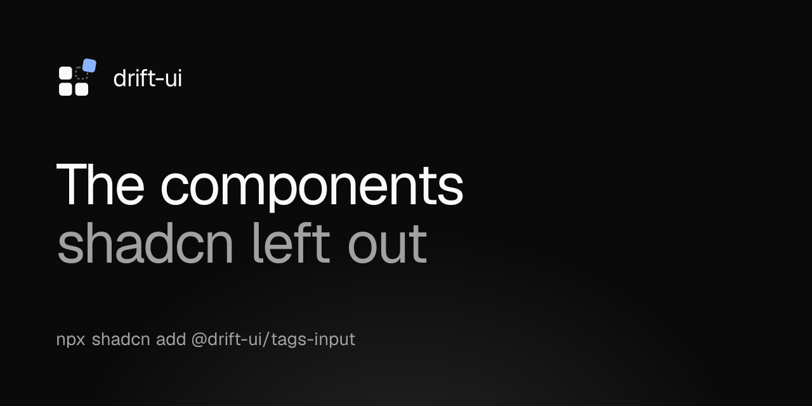

# drift-ui



A shadcn-compatible component registry built on React 19, Tailwind v4, and Radix or Base UI. It covers the components shadcn/ui leaves out, like a tags input, stepper, tree view and file dropzone, and installs them with the shadcn CLI.

Browse the live previews at [drift-ui-dev.vercel.app](https://drift-ui-dev.vercel.app).

## Components

| Category   | Components                                                                                                                                                                            |
| ---------- | ------------------------------------------------------------------------------------------------------------------------------------------------------------------------------------- |
| Inputs     | tags-input, multi-select, number-input, password-input, date-time-range, time-field, recurrence-editor, color-picker, mention-textarea, shortcut-recorder, file-dropzone, inline-edit |
| Structure  | tree-view, stepper, timeline                                                                                                                                                          |
| Workflow   | filter-builder, bulk-action-bar, tour                                                                                                                                                 |
| Primitives | button, badge, input, label, card, dialog, popover                                                                                                                                    |

The primitives have the same API as their shadcn/ui counterparts, so skip any you already have. Every component has a live preview, its source and install steps at [`/components/<name>`](https://drift-ui-dev.vercel.app/components).

## Usage

In a project that already ran `npx shadcn init`, register the namespace in `components.json`:

```json
{
  "registries": {
    "@drift-ui": "https://drift-ui-dev.vercel.app/r/{style}/{name}.json"
  }
}
```

The shadcn CLI fills in `{style}` from your `components.json`. A `base-` style such as `base-nova` gets the Base UI build, which never installs `radix-ui`, and any other style gets Radix. Namespaces registered with the older `/r/{name}.json` URL keep getting Radix.

Then install the theme and any component:

```bash
npx shadcn add @drift-ui/theme @drift-ui/tags-input @drift-ui/tree-view
```

Registry dependencies such as `utils`, `button` and `use-controllable-state` are installed automatically.

### For AI agents

The site serves [`/llms.txt`](https://drift-ui-dev.vercel.app/llms.txt) with an index of the registry and [`/llms-full.txt`](https://drift-ui-dev.vercel.app/llms-full.txt) with install commands, usage notes and examples for every component.

## Develop

```bash
git clone https://github.com/localhostd3veloper/drift-ui.git
cd drift-ui
bun install
bun run registry:build
bun dev
```

The site runs at <http://localhost:3000> and the built registry at <http://localhost:3000/r/{name}.json>.

| Command                  | What it does                                   |
| ------------------------ | ---------------------------------------------- |
| `bun dev`                | Start the dev server                           |
| `bun run registry:build` | Rebuild `public/r/*.json` from `registry.json` |
| `bun run test`           | Run the Vitest suite                           |
| `bun run typecheck`      | Type-check with `tsc --noEmit`                 |
| `bun run lint`           | Run ESLint                                     |
| `bun run format`         | Format with Prettier                           |
| `bun run build`          | Build the registry, then the production site   |

## Layout

```text
registry.json                  item manifest read by `shadcn build`
registry/default/ui/*.tsx      component source
registry/default/lib/*.ts      cn() helper and pure logic behind components
registry/default/hooks/*.ts    shared hooks such as use-controllable-state
components/preview/*           live demos, also used as usage examples in the docs
components/docs/*              docs site UI
components/landing/*           landing page sections
lib/catalog.ts                 component categories and ordering
lib/agent-docs/*               content for /llms.txt and /llms-full.txt
tests/                         Vitest suites for components and lib code
public/r/*.json                build output, served as static files
```

## Contributing

Bug reports, component requests and pull requests are welcome. Open an [issue](https://github.com/localhostd3veloper/drift-ui/issues/new/choose) to report a bug or request a component. Read [CONTRIBUTING.md](CONTRIBUTING.md) for setup, the steps to add a component, and the commit conventions. Coding agents start from [AGENTS.md](AGENTS.md). Everyone with a merged pull request is listed on the [contributors page](https://drift-ui-dev.vercel.app/contributors).

## License

[MIT](LICENSE)
